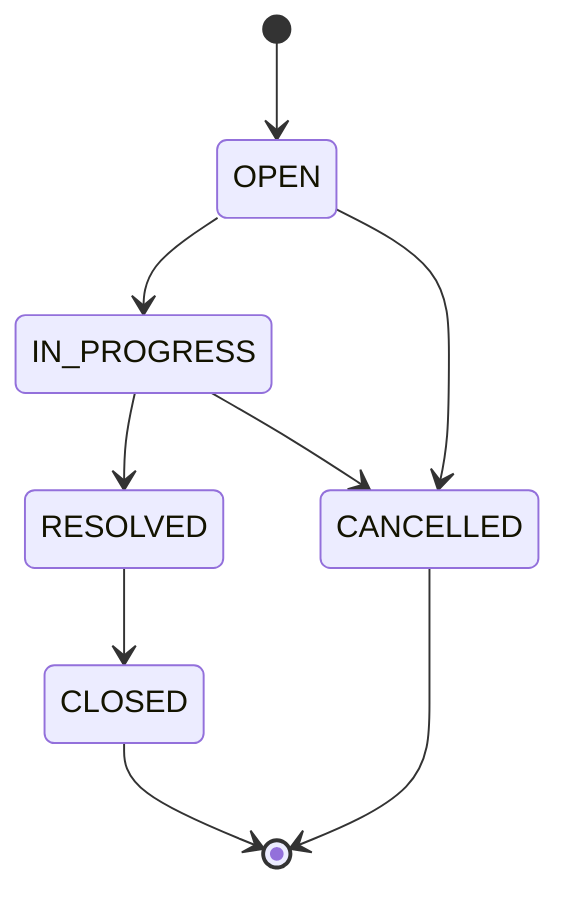

# State Machine

## States
`OPEN`, `IN_PROGRESS`, `RESOLVED`, `CLOSED`, `CANCELLED`

## Allowed transitions

| From \ To | OPEN | IN_PROGRESS | RESOLVED | CLOSED | CANCELLED |
|-----------|------|-------------|----------|--------|-----------|
| OPEN        | ❌ | ✅ | ❌ | ❌ | ✅ |
| IN_PROGRESS | ❌ | ❌ | ✅ | ❌ | ✅ |
| RESOLVED    | ❌ | ❌ | ❌ | ✅ | ❌ |
| CLOSED      | ❌ | ❌ | ❌ | ❌ | ❌ |
| CANCELLED   | ❌ | ❌ | ❌ | ❌ | ❌ |

25 combinations: 5 allowed, 20 rejected (including 5 same-state).

## Rules
- Single source of truth: `TicketStatus.allowedTransitions()` (enum-held rules, ordered). The only way to change status is `Ticket.transitionTo(target)`, which enforces them; there is no public status setter.
- Enforcement lives only in the service layer; the UI merely hides illegal options and is never trusted.
- Rejected transition → `InvalidStatusTransitionException` → HTTP 409, code `INVALID_STATUS_TRANSITION`, message includes from, to and allowed targets in lifecycle (enum) order, e.g. `Cannot transition from OPEN to CLOSED. Allowed: IN_PROGRESS, CANCELLED`.
- Status changes happen only via `POST /api/tickets/{id}/transitions`; `PATCH` ignores/rejects a `status` field (400 on unknown property).
- Transition updates `updatedAt`. Terminal states reject field edits (see requirements A3).
- Unknown status value in request → 400 `VALIDATION_ERROR`.
- Transitions are concurrency-safe via optimistic locking (`@Version`); conflict → 409 `CONCURRENT_MODIFICATION`.
